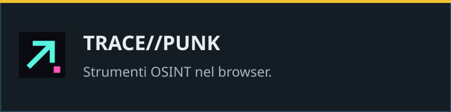

## Progetti in evidenza

Strumenti pratici, automazioni e qualche idea quasi sensata.

| | |
| :--- | :--- |
|  |  |
|  |  |
|  |  |

[Prova TRACE//PUNK](https://tracepunk.laccorsi-bondeno.workers.dev/) · [Tutti i repository](https://github.com/realfulvio?tab=repositories)

---

Windows · Linux · Rust · Python · TypeScript
